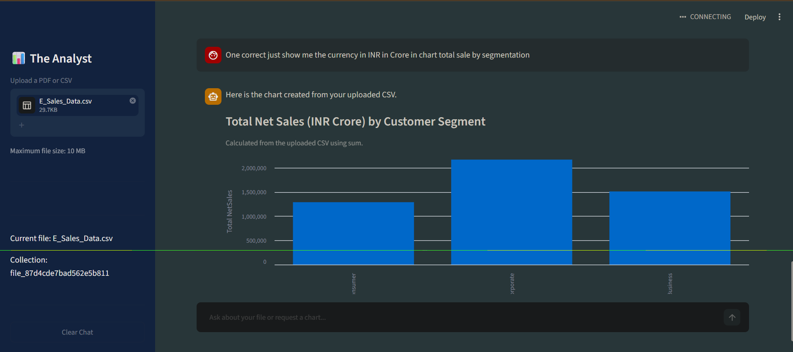

# 📊 The Analyst

**Your Data. Our Insight.**

**The Analyst** is an AI-powered data assistant built with **Streamlit**, **Groq**, and **ChromaDB**. Upload a **CSV** or **PDF** file, ask questions in plain English, and get answers grounded in your file (RAG), plus interactive charts for CSV data.

---

## ✨ Features

- 📁 **Upload CSV or PDF** files (max 10 MB)
- 💬 **Chat interface**: ask questions about your file in natural language
- 🔍 **RAG-based Q&A**: file content is chunked, embedded, and stored in a local ChromaDB vector database, and the most relevant chunks are retrieved for each question
- 📄 **Source-aware answers**: answers cite PDF pages or CSV row ranges
- 🧾 **CSV dataset overview**: row and column counts, data types, missing values, and a data preview
- 📈 **Natural-language visualizations** for CSV files. Supported charts:
  `bar`, `stacked bar`, `line`, `area`, `pie`, `donut`, `scatter`, `histogram`, `box`, `heatmap`
- 🧮 **Aggregations**: `sum`, `mean`, `count`, `min`, `max`
- 🛡️ **Safe chart generation**: the LLM only picks chart settings (as JSON). All calculations are done locally with Pandas on the full CSV, and the LLM never supplies data values or runs code
- 🔎 **Retrieved chunks viewer** to see exactly what context the AI used
- 🧹 **Clear Chat** button
- 🔐 **Secrets in `.env`**: API keys are never committed

---

## 📸 Screenshots

### Chat & Visualization


---

## 🛠️ Tech Stack

| Category | Tools |
|----------|-------|
| Frontend / UI | Streamlit |
| Language | Python 3.11+ |
| LLM | Groq API (default model: `openai/gpt-oss-120b`) |
| Vector Database | ChromaDB (persistent, stored in `./my_database`) |
| Data Processing | Pandas, NumPy |
| PDF Parsing | pypdf |
| Text Splitting | LangChain Text Splitters |
| Charts | Vega-Lite via `st.vega_lite_chart` |
| Config | python-dotenv |

---

## 📂 Project Structure

```
The-Analyst/
├── .streamlit/          # Streamlit configuration
├── .gitignore           # Files and folders excluded from Git
├── README.md            # Project documentation
├── Visualization.png    # Screenshot used in the README
├── app.py               # Main application (UI, RAG pipeline, charts)
└── requirement.txt      # Python dependencies
```

**Created locally when you run the app (git-ignored, not in the repo):**

```
├── .env                 # Your secrets (GROQ_API_KEY, GROQ_MODEL)
├── .venv/               # Your virtual environment
└── my_database/         # Local ChromaDB vector store
```

---

## 🧠 How It Works

1. **Upload**: a PDF or CSV is uploaded from the sidebar.
2. **Extract**: PDF text is read page by page. CSVs are turned into a dataset summary plus row batches.
3. **Chunk**: text is split into chunks (`chunk_size=1000`, `chunk_overlap=150`).
4. **Store**: chunks are saved in ChromaDB, in a collection named after the file hash.
5. **Ask**: when you ask a question:
   - **Chart request (CSV)**: Groq returns a JSON chart plan, the plan is validated against your real columns, and Pandas computes the data and renders the chart.
   - **Normal question**: the top 5 most relevant chunks are retrieved, and Groq answers using only that context.

---

## 🚀 Getting Started

### Prerequisites

- Python **3.11 or higher**
- A free **Groq API key**: get one at [console.groq.com](https://console.groq.com)

### 1. Clone the repository

```bash
git clone https://github.com/thiro2003/The-Analyst.git
cd The-Analyst
```

### 2. Create and activate a virtual environment

**Windows (PowerShell):**
```powershell
python -m venv .venv
.venv\Scripts\Activate.ps1
```

**macOS / Linux:**
```bash
python3 -m venv .venv
source .venv/bin/activate
```

### 3. Install dependencies

```bash
pip install -r requirement.txt
```

### 4. Configure environment variables

Create a file named `.env` in the project root (next to `app.py`):

```env
GROQ_API_KEY=your_groq_api_key_here
GROQ_MODEL=openai/gpt-oss-120b
```

> `GROQ_MODEL` is optional. If omitted, `openai/gpt-oss-120b` is used.
> ⚠️ Never commit your `.env` file. It is already in `.gitignore`.

### 5. Run the app

```bash
streamlit run app.py
```

Then open **http://localhost:8501** in your browser.

---

## 💡 Example Prompts

**Questions (CSV or PDF)**
- `Give me an overview of this dataset`
- `Are there any missing values?`
- `What columns does this file have?`
- `Summarize this PDF`
- `What are the key points on page 3?`

**Charts (CSV only)**
- `Show total net sales by customer segment`
- `Make a pie chart of total spend by account`
- `Create a scatter plot of age versus income`
- `Show a histogram of sales`
- `Make a heatmap of region and product showing total revenue`
- `Change the previous chart to a line chart`

---

## ⚠️ Limitations

- Maximum upload size is **10 MB**.
- Text answers about CSV data are based on the **retrieved chunks** (top 5), so they may not cover the entire dataset. For full-dataset calculations, use the **chart feature**, which computes on all rows.
- Charts show at most **30 categories**. Bar, line, and area charts show the top 30 (with a warning), while pie, donut, box, heatmap, and stacked bar charts raise an error instead.
- Pie and donut charts cannot show negative values.
- Scanned PDFs without selectable text are not supported (no OCR).
- CSV files must not have duplicate column names.

---

## 🔒 Security Notes

- API keys are stored in `.env` and excluded from Git.
- `.streamlit/secrets.toml` and the local `my_database/` folder are git-ignored.
- The LLM never executes code. It only returns a validated chart configuration.
- Instructions found inside uploaded files are treated as data, not commands.

---

## 🗺️ Roadmap

- [ ] Excel (`.xlsx`) support
- [ ] Built-in automated EDA report (correlations, distributions, outliers)
- [ ] Currency and number formatting (e.g., INR Crore) applied directly to charts
- [ ] Export charts and reports
- [ ] Multi-file analysis
- [ ] Deploy on Streamlit Community Cloud

---

## 🤝 Contributing

1. Fork the repo
2. Create a branch: `git checkout -b feature/your-feature`
3. Commit: `git commit -m "Add your feature"`
4. Push: `git push origin feature/your-feature`
5. Open a Pull Request

---

## 📄 License

This project is licensed under the MIT License.

---

## 👤 Author

**thiro2003**
- GitHub: [@thiro2003](https://github.com/thiro2003)

⭐ If you like this project, give it a star!
